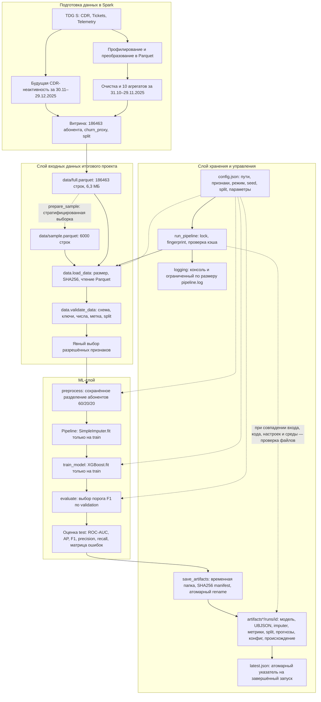

# Архитектура конвейера

В Docker выполняется тот же `main.py`; `/outputs` связывается с папкой Windows.
После завершения контейнер сохраняется; повторный запуск — `docker start -a <имя>`.
Spark-слой формирует витрину признаков и меток. Точка входа `main.py` начинает
выполнение с чтения `data/full.parquet` или `data/sample.parquet`.
Окна признаков и ограничения доступности поздних данных приведены в README.

Статистическая предобработка расположена **после разделения**: медианы не вычисляются
по validation/test. В режиме `stratified` используется новое разбиение с seed из
конфигурации; вариант `preserved` использует группы из столбца `split`.
